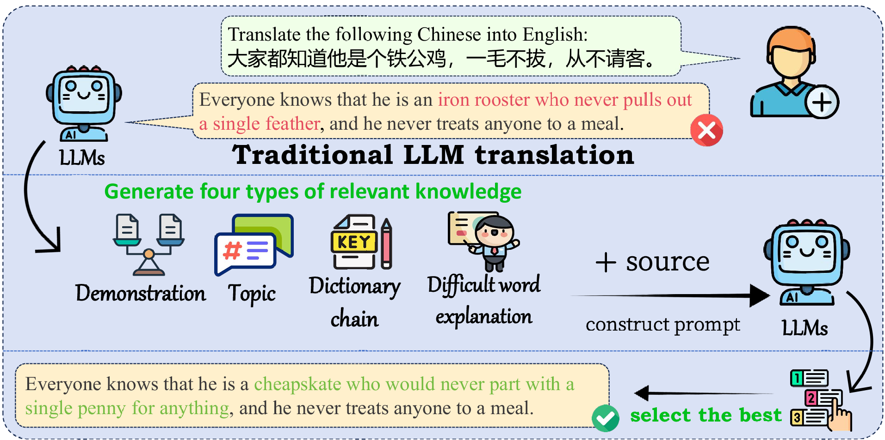
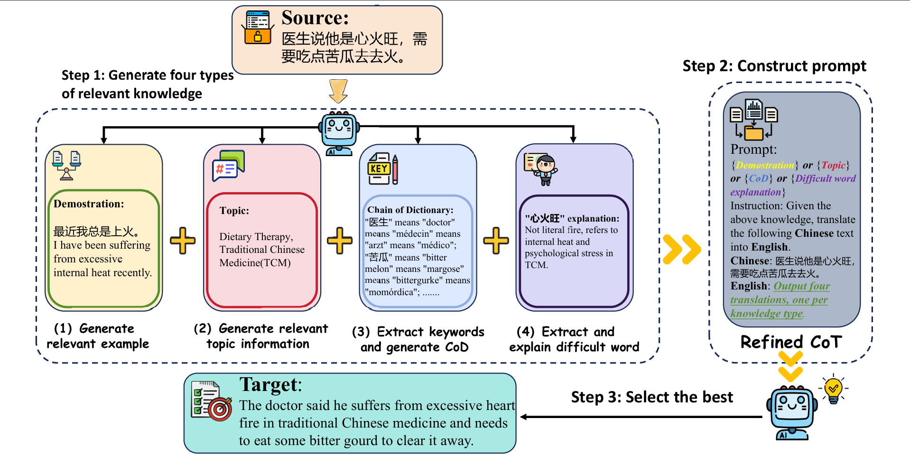
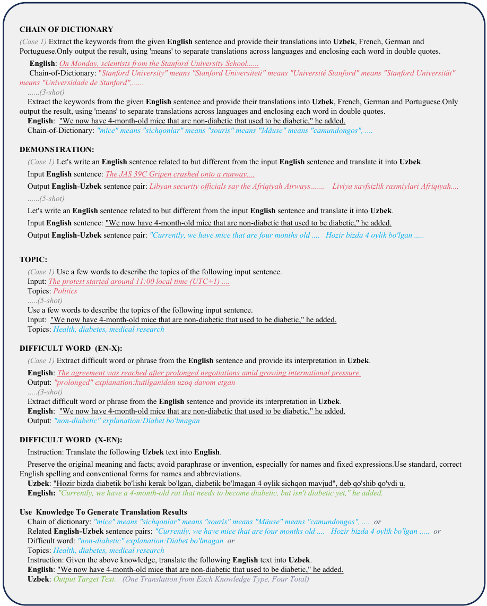

# Official Repo of Knowledge-to-Translation (KnT)

Official implementation of **KnT: A Multi-Source Knowledge-Driven Framework for Low-Resource Machine Translation** with complete pipelines, scripts, and model outputs.

<p align="center">
  
  <br>
  <em>Fig. 1: Multi-source reasoning for low-resource languages translation (An Example)</em>
</p>

---

# Table of Contents

1. [Overview of the KnT Framework](#overview)
2. [Supported Benchmarks & Language Pairs](#supported-benchmarks--language-pairs)
3. [Repository Structure](#repository-structure)
4. [Installation & Requirements](#installation--requirements)
5. [Running Experiments](#running-experiments)
    - 5.1 [Data Setup](#51-data-setup)
    - 5.2 [Baseline: Zero-Shot Translation](#52-baseline-zero-shot-translation)
    - 5.3 [Proposed Method: KnT Pipeline](#53-proposed-method-knt-pipeline)
    - 5.4 [Evaluation](#54-evaluation)

---

# Overview

*Knowledge-to-Translation* (**KnT**) is a multi-source reasoning framework designed to assist Large Language Models (LLMs) in tackling the Machine Translation (MT) task, with a particular emphasis on low-resource languages (LRLs). While LLMs excel in general tasks, they still underperform compared to supervised systems when translating to or from resource-constrained languages due to data scarcity.

KnT addresses this limitation by injecting multi-dimensional, structured knowledge during the decoding process. The framework extracts, filters, and leverages four complementary types of knowledge:

* **Exemplar Knowledge (`.demo`):** Dynamically generates contextually relevant translation demonstrations tailored specifically to the structural or semantic features of the source sentence.
* **Chain-of-Dictionary (`.cod`):** Extracts key words from the source sentence to adaptively construct lexical reasoning chains, linking specific source words to their target dictionary translations.
* **Topic Knowledge (`.topic`):** Extracts sentence-level thematic background information to guide the semantic focus of the translation.
* **Difficult Words (`.dw`):** Identifies low-frequency or ambiguous tokens in the source text and provides explicit word-level explanations.

<p align="center">
  
  <br>
  <em>Fig. 2: Construction Process of refined CoT (The Detailed KnT Framework)</em>
</p>

The core pipeline operates in a modular fashion, combining automated knowledge generation guided by tailored instructions, an independent Knowledge Selection mechanism based on reference-free quality estimation to filter the best candidates, and a final Knowledge-Augmented Translation step. All underlying templates used across these inference stages are systematically defined.

<p align="center">
  
  <br>
  <em>Fig. 3: Comprehensive List of Prompts Employed in the KnT Framework</em>
</p>

---

# Supported Benchmarks & Language Pairs

The KnT framework is comprehensively evaluated across **6 major MT benchmarks**, spanning various language pairs and domains:

| Dataset | Direction & Covered Language Pairs |
| --- | --- |
| **FLORES-200** | `en-fa`, `fa-en`, `en-lo`, `lo-en`, `en-ur`, `ur-en`, `en-uz`, `uz-en` |
| **IWSLT** | `zh-fa`, `zh-he`, `zh-id`, `zh-vi` |
| **CCMatrix** | `zh-fa`, `zh-he`, `zh-id`, `zh-bn`, `zh-vi` |
| **NTREX-128** | `en-he`, `en-lo`, `en-ur`, `en-bn` |
| **CCMT-2025** | `en-zh`, `ug-zh`, `bo-zh` |
| **Tico-19** | `en-bn`, `en-ur`, `zh-bn`, `zh-ur` |

> *Note on Language Codes: `fa` (Persian), `lo` (Lao), `ur` (Urdu), `uz` (Uzbek), `bn` (Bengali), `ug` (Uyghur), `bo` (Tibetan), `he` (Hebrew), `id` (Indonesian), `vi` (Vietnamese), `zh` (Chinese), `en` (English).*

---

# Repository Structure
```text
KnT-master/
├── data/
│   ├── raw/                               # Raw benchmark source datasets
│   └── Qwen3-30B-A3B-Instruct-2507/        # Data processing and prompt construction code
├── model/
│   └── Qwen3-30B-A3B-Instruct-2507/
│       └── translate.py                   # Main inference script executing the LLM translation
├── scripts/
│   ├── knowledge-selection.py            # Filters and selects optimal knowledge components
│   └── score.py                          # Evaluation script calculating translation metrics (e.g., BLEU, COMET)
├── output/
│   └── Qwen3-30B-A3B-Instruct-2507/       # Saved output directories organized by model
│       └── flores200.en-fa/               # Example: English-to-Persian outputs
│           ├── flores200.en-fa.en.demo    # Extracted Exemplar Knowledge
│           ├── flores200.en-fa.en.cod     # Chain-of-Dictionary Knowledge
│           ├── flores200.en-fa.en.topic   # Topic-Level Knowledge
│           ├── flores200.en-fa.en.dw      # Difficult Word Explanations
│           ├── flores200.en-fa.fa.demo    # Translation via Exemplar Knowledge
│           ├── flores200.en-fa.fa.cod     # Translation via Chain-of-Dictionary Knowledge
│           ├── flores200.en-fa.fa.topic   # Translation via Topic-Level Knowledge
│           └── flores200.en-fa.fa.dw      # Translation via Difficult Word Explanations
├── knt.sh                                 # Master runner shell script for the KnT pipeline
├── Direct.sh                              # Runner shell script for the Zero-Shot baseline
└── eval.sh                                # Automatically triggers evaluation across outputs
```

---

# Installation & Requirements

Before running the scripts, ensure that you have configured your Python environment and installed the necessary deep learning backends (such as PyTorch and efficient inference engines like vLLM).

```bash
git clone [https://anonymous.4open.science/r/KnT-E6F8](https://anonymous.4open.science/r/KnT-E6F8)
cd KnT-master/
pip install -r requirements.txt

```

---

# Running Experiments

> **Core Experimental Settings:**
> - **Hardware:** Single NVIDIA H100 (80GB).
> - **Decoding Strategy:** Greedy decoding (temperature = 0).
> - **Random Seed:** 0.

### 5.1 Data Setup

Place all original benchmark source files into `data/raw/`. The pipeline code specific to your backbone model configuration (e.g., `Qwen3-30B-A3B-Instruct-2507`) should be systematically structured under `data/Qwen3-30B-A3B-Instruct-2507/`.

### 5.2 Baseline: Zero-Shot Translation

To execute standard direct, zero-shot inference without integrating any external knowledge snippets, simply run:

```bash
bash direct.sh
```

### 5.3 Proposed Method: KnT Pipeline

To run the complete **KnT** process, execute the master shell script `knt.sh`. This script automatically sequences the workflow through three major phases:

* **Knowledge Generation (Steps 1-2):** Formats the prompts and runs `translate.py` to generate source-sentence knowledge elements (`demo`, `topic`, `cod`).
* **Knowledge-Augmented Translation (Steps 3-4):** Integrates the generated knowledge to prompt the LLM again, producing multiple distinct translation candidates.
* **Quality Selection (Step 5):** Triggers `knowledge-selection.py` to leverage a reference-free Quality Estimation model (`wmt23-cometkiwi-da-xl`) to score all candidates and filter the best final output.

```bash
bash knt.sh
```

During or after execution, the generated multi-source knowledge elements and intermediate translations will be saved in the corresponding task directory, for example: `output/Qwen3-30B-A3B-Instruct-2507/flores200.en-fa/`.

### 5.4 Evaluation

To automatically compute automated evaluation metrics for your generated translations against references via `scripts/score.py`, run:

```bash
bash eval.sh
```

Note on Cache: The evaluation process will automatically download or generate metric cache files. These files are stored locally in the KnT-master/KnT/cache/ directory.